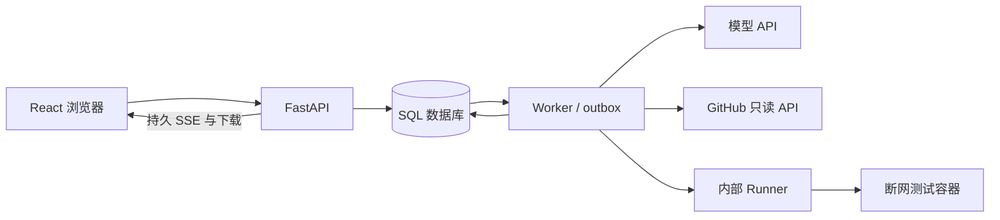

# 架构与信任边界

API 在创建事务中同时写入 task、初始事件和 outbox；Worker 通过任务行锁领取并生成新的 lease token。重复消息不能领取第二次有效执行。PostgreSQL 使用事务 advisory lock 串行化同一会话的创建，SQLite 开发模式使用 `BEGIN IMMEDIATE`。

每次状态与产物写入核对有效 token 和心跳。回收者先更换 token，再清理旧 Runner execution，最后标记 interrupted。旧 Worker 的迟到写入被拒绝，不自动覆盖旧历史或复用不完整结果。重试创建关联新任务。

事件持久存在数据库中，seq 在快照更新的同一事务递增。订阅先读取快照游标，重连优先使用 Last-Event-ID，按序补发；HTTP 流断开不取消任务。前端按 seq 去重并重新读取权威快照，另以轮询恢复最终状态。

源码与日志是数据，不具有控制权限。模型交付经过 schema 和证据 ID 检查的源码修改。可选工具模式只开放当前任务归档读取、本次 rollout 候选及登记检查，没有任意 shell。Runner 接收案例或登记快照绑定、固定 check ID 和受校验补丁，不接收任意命令。每次执行创建干净副本。补丁不能修改测试、配置、依赖或 workflow。

候选检查与最终验收使用不同 execution ID 和全新副本。通过条件包括：原目标失败指纹匹配、进程成功、非零测试收集、完整回归通过、原有测试身份未消失、跳过未增加、命令与环境/测试指纹一致，以及选中 patch hash 一致。JUnit 是验证依据之一，不能以模型自述代替 Runner 结果。

Docker 测试容器非 root、只读系统和源码挂载、独立可写产物目录、断网、禁用 capabilities/提权，并限制 CPU、内存、PID、文件大小及时间。Docker socket 仅属于 Runner 所在的高权限执行边界。产物目录不包含源码，避免可写挂载绕过源码只读限制。

Runner 支持本地演示案例，以及服务器明确登记仓库、SHA、workflow、Job 与镜像的远程快照。后者只能使用 Docker；可信本机模式仅供受信任的本地案例。接收陌生仓库、公开部署、磁盘配额、容器 OOM 精确分类、保留期与强隔离仍需要单独设计和部署验收。

远程归档由 Runner 通过受限公开地址下载和校验，Worker 只获得清单、workflow 和受限源码文本；后者仅用于材料与补丁校验，不在 Worker 执行。每次 Runner 检查重读缓存指纹并创建独立副本，任务归档完整 profile 和清单，配置变化或证据不匹配会阻止模型调用或 repaired 结论。详见[远程接入](remote.md)。

当前 artifacts 的文本内容保存在数据库中，保证下载内容、证据及 hash 原子一致；大产物和保留期清理留到后续对象存储阶段。原始测试日志在入库前脱敏，patch 如需要脱敏会直接拒绝，避免归档时改变已验证的字节。

日志失败索引绑定完整脱敏产物 SHA256 和原始行号。模型节选记录保留 / 省略范围及截断行，作为独立产物归档；浏览器通过有权限及完整性检查的行 / 列游标分页读取。完整日志、模型节选与测试通过结论各自保留，不把启发式错误标记当作验证标签，见[日志证据](logs.md)。

API 与 Worker 不再隐式自动建表，启动时核对 Alembic head。`scripts/migrate.py` 负责升级；接管旧数据库必须显式选择 `--adopt-existing`，逐表比较结构，SQLite 先做一致备份。

模型既可交付严格 unified diff，也可交付路径、唯一原文片段与替换文本。后者由平台生成 diff，并继续应用相同的源码范围、大小、上下文、测试完整性、补丁哈希与独立验收约束；原始模型响应保留为独立产物。

工具模式通过原生 Function Calling 执行有限轮观察和交付。模型调用前预留 schema 与完整消息历史预算；工具观察使用真实 Runner 结果，交付后平台另做候选及最终独立检查。工具模式的模型响应归档仅存公开调用元数据和参数 hash，经过校验的请求及返回独立归档，不保存助手自由文本与私有推理。详见[Agent 工具诊断](agent-tools.md)。

开发集评测在单独表中固定清单、配置、执行顺序及终态输入。下一任务和 outbox 在同一事务创建，继续遵守 owner 额度及 Worker fencing；不会并发安排同一个实验项。配置与实现指纹在执行和模型调用前核对。后续重新验证不改变已冻结的评测输入，导出证据包可在无网络、无模型调用的环境重算公开指标。此处没有私有评测器或隐藏标准，详见[评测范围](evaluation.md)。

四组协议由服务端写入任务归属与执行规则，不能通过普通任务请求注入。日志组跳过源码材料构建及 Runner，仅读取预先归档且校验的公开日志。独立多次组使用同一初始材料，每次重新建立模型 / 工具上下文，并共享任务总预算；其他 rollout 的候选和执行不进入工具可见范围。旧版任务与两组报告保持原有逻辑。

独立评分服务只在整批完成后接收固定补丁、源码身份和公开验收事实。私有断言位于工作区外；候选容器只接收输入，期望答案由受信任的协调进程比较。结果通过绑定报告 / 请求 / 候选 / 评分包 / 镜像的签名回执进入单独评分表，不回流到 Worker、模型或原公开报告。新增回归仅在原先通过的私有行为子集中判断，环境错误保持未评分。服务部署及本机隔离边界见[独立评分](scoring.md)。
