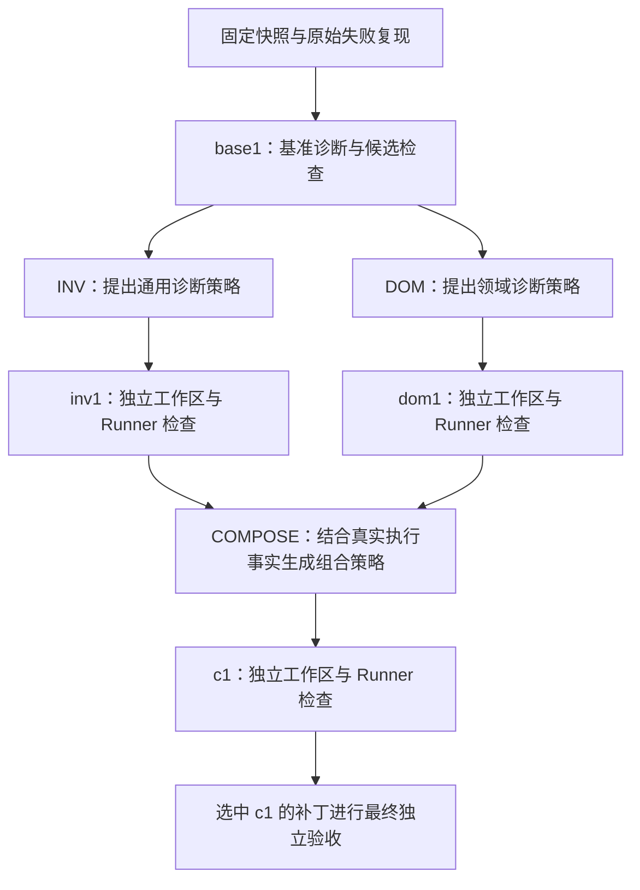

# Harness² 自适应诊断

已接通指南固定 commit `1cfe254e8d25b15f37048c3730134686abe60335`，并完成本地案例的真实 DeepSeek + Docker + 浏览器验收。入口为原生 `harness2.core.schedule.run_task(k=1, modes=("seq",), seed=42)`；未修改上游源码。

## 启用与运行

项目使用上游支持的 Python 3.12 / 3.13。安装锁定的可选依赖：

```sh
uv sync --locked --extra adaptive
uv run --extra adaptive python scripts/check_harness.py --demo
```

`--demo` 运行上游确定性本地示例的顺序和并行两种模式，不请求模型。它用于验证框架兼容性；真实修复验收单独执行。

配置服务端 `.env`，保留已有模型连接、Runner 令牌和固定镜像：

```dotenv
BUILDMEDIC_ADAPTIVE_ENABLED=true
```

然后启动：

```sh
uv run --extra adaptive python scripts/dev.py --web
```

创建任务时选择演示案例，或预览并选择已登记的 GitHub 失败 Job，然后选择“自适应诊断”。默认推荐 12 次模型调用、100,000 tokens；服务端要求至少 7 次调用与 48,000 tokens。预算不足会正常结束并保留已有证据，不会自动扩大额度。未登记的 GitHub 来源仅开放日志诊断；[远程接入说明](remote.md)介绍如何固定提交与执行环境。

运行时核对已安装包的 Git URL 和完整 commit。缺少可选依赖、版本不匹配、功能开关关闭或模型未配置时，页面禁用此模式并给出原因。`uv run` 不加 `--extra adaptive` 可能同步回仅包含标准功能的环境，请使用上面的启动命令。

## 实际执行流程



正常 `k=1` 流程包含 4 次诊断、3 次策略提议，共 7 次模型调用。格式错误最多追加一次受预算约束的修正请求。INV/DOM 由上游并发调度，实际请求通过 HTTP 桥接的串行锁领取预算，启动先后顺序可变化；命名和独立性保持不变。

上游的 `finals-only` 约定在 `k=1` 下只有一个组合最终结果 `c1`，直接采用它，不产生额外选择模型调用，也不按测试结果偷偷换回较早的候选。`delivered=True`、框架 `status=ok` 只表示有效交付；最终 `repaired` 仍必须有原失败复现、选中 patch hash 以及额外干净副本上的目标与完整回归证据。

## 适配边界

`CIRepairAdapter` 实现固定版本的 BenchmarkAdapter 契约：任务、领域、材料、执行、交付物、轨迹、基础策略与验证。`score()` 返回 None，优化阶段不使用隐藏判定信息。

`HTTPProposer` 是原生 Proposer 的自定义 HTTP 实现，通道明确命名为 `buildmedic_http`。该固定版本的提示词只认识 OpenCode/Codex 文件表面，因此桥接复用 OpenCode Markdown 布局，执行器标识为 `bounded-http`。没有启动 OpenCode、Claude CLI 或其他带任意 shell 权限的执行器。

可修改的文件只有：

- `harnesses/base/systemprompt.md` 对应的任务私有副本。
- `tool_descriptions/tool_guidance.md`。
- `skills/pytest-repair/SKILL.md`。

`guardrails.md` 和 `LongTermMEMORY.md` 必须与基础文件逐字一致。不能增删路径、增加脚本/插件/子 Agent、修改固定测试计划、安装依赖、调整预算或跳过独立验证。策略只作为模型诊断指导，实际补丁继续经过同一源码范围与测试完整性检查。

每个 Web task 与 lease token 有唯一运行目录，每个 rollout 再创建独立源码工作区。Runner 的每次检查另从固定原始案例创建干净副本，不共享候选改过的源码。可主动开启同会话的同域 Library：任务创建时冻结输入，上游只写任务私有副本，独立验证通过后由用户发布版本。详见[任务经验管理](experience.md)。

同步上游调度运行在线程中，模型和 Runner 请求回到 Worker 的同一事件循环。桥接在释放串行锁前记录硬停止原因，让排队中的请求也停止；取消、预算耗尽、失效 lease 和账户级模型错误会跨过上游的容错异常捕获，不继续发起后续付费请求。

## 页面、产物与用量

任务详情的“策略记录”展示实际 INV/DOM/COMPOSE 阶段、保留基准/修改/回退状态、策略差异、逐次模型调用及框架执行报告。每个 rollout 可下载对应策略快照。事件持久化，刷新后从权威快照恢复。

所有诊断、提议、可选反思和格式修正请求共用 Context 预算与调用账本。服务商用量缺失时保留保守预留；上游 ledger 中的占位 USD 不作为计价依据，面向用户的报告转换为未知。开启经验反思后推荐新任务使用 12 次调用、150,000 tokens；原有任务上限保持不变。仍未声称任何通用成功率或策略收益。

可显式设置 `agent_tools=true`，让每个 Solver rollout 使用原生工具循环。INV / DOM / COMPOSE 提议仍使用原有结构化接口。各 rollout 的工具候选、检查和预算记录分别归属；工具检查不会替代候选及最终独立验收。完整轨迹带有实际工具活动和证据，取消、预算或环境阻塞通过桥接硬停止。推荐新任务 24 次 / 250,000 Token；开关缺省关闭，详见[Agent 工具诊断](agent-tools.md)。

轨迹保留全部公开测试身份、计数、命令、退出码和可用输出；完整 Runner 原始产物及平台指纹另行归档。HTTP 传输压缩 JSON 空白，并用 `context_file_aliases` 无损表示重复文件，不截掉失败证据来满足预算；超出输入或任务预算时直接停止。

## 本轮验收

- 官方本地 demo：两个任务、顺序及并行模式，零失败。
- 原生调度集成测试：策略修改、四个 rollout、独立验收、失败最终结果、不可变约束、格式重试、取消、预算硬停止与模型账户错误。
- 真实浏览器任务：`5460eed14771458aa1fa5faab8533a2a`。
- 模型：`deepseek-flash`，7 次调用、45,613 个服务商报告的 tokens。
- INV、DOM、COMPOSE 三个阶段都产生实际修改；4 个 rollout、12 次 Docker 检查，组合补丁最终独立验收通过。
- 页面已验证模式选择、预算、策略差异、组合采用记录与刷新恢复。截图和原始结果在被忽略的 `var/acceptance/harness-*`。

首轮真实任务在组合前触发保守预算保护，已保留为 `budget_exhausted`。随后压缩轨迹表示；另一次运行在 DOM 格式错误后如实回退，并仍通过组合验收。最终上列新任务通过完整浏览器检查。这些历史没有改写成成功。

可重复执行真实验收（会产生模型用量）：

```sh
cd apps/web
npm run test:live -- --grep 'adaptive:'
```

远程固定 SHA 快照、登记 profile 与自适应执行已实现，并通过真实 Docker、模拟 GitHub 与脚本模型的集成检查；真实失败 Run 的端到端验收仍待执行。同会话的同域经验发布及公开开发集四组对照已接通。真实三个修复组均 3/3 通过公开检查，Harness² 消耗更多，未显示通过数收益；日志组只交付未评分诊断，见[评测记录](evaluation.md)。隐藏行为与分组隔离测试集评测仍未完成，不能把开发验收称为整个 P1/P2 已完成。

上游来源：[spec.py](https://github.com/google-research/harness2/blob/1cfe254e8d25b15f37048c3730134686abe60335/harness2/core/spec.py)、[schedule.py](https://github.com/google-research/harness2/blob/1cfe254e8d25b15f37048c3730134686abe60335/harness2/core/schedule.py)、[recursion.py](https://github.com/google-research/harness2/blob/1cfe254e8d25b15f37048c3730134686abe60335/harness2/core/recursion.py)、[demo.py](https://github.com/google-research/harness2/blob/1cfe254e8d25b15f37048c3730134686abe60335/harness2/demo.py)。
